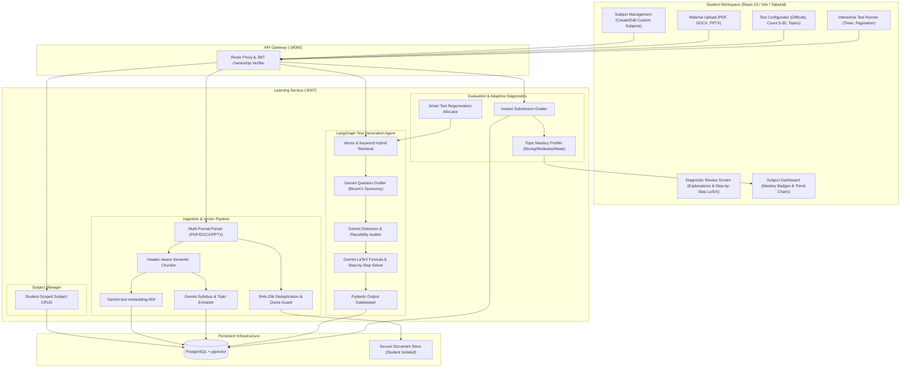

# Self-Learning Module: AI-Powered Automatic Test Generation & Evaluation
## Professional Architecture, Google Gemini Integration & 4-Phase Roadmap

> **Document Version:** 2.3.0  
> **Target System:** SmartEdu Platform — Student Self-Learning & Mastery Engine  
> **Core AI Engine:** Google Gemini API (`gemini-2.0-flash` / `gemini-1.5-pro` & `text-embedding-004`) via LangGraph & LangChain  
> **Deployment Architecture:** Vercel Full-Stack Serverless + Neon Managed PostgreSQL (Pooler Mode)  
> **Gateway Status:** Verified 200/201 across all 12 core student endpoints (Identity, Attendance, Scheduling/Timetable, Notifications, Assessments, Learning Resources/Recommendations/Activity, Finance Portal, Token Refresh).
> **Key Capabilities:** Dynamic Student-Created Subjects, Multi-Format Ingestion (PDF/DOCX/PPTX), Vector RAG, Bloom's Taxonomy Test Authoring, Step-by-Step LaTeX Numerical Solutions, Adaptive Weak-Topic Regeneration.

---

## 1. Executive Summary & Vision

The **Self-Learning Module** is an autonomous, student-driven study workspace within the University Management System. Because students belong to diverse academic departments (e.g., Computer Science, Mechanical Engineering, Health Sciences, Law, Economics, Humanities), the system **does not constrain students to a rigid institutional curriculum**. Instead, students independently:

1. **Create and manage their own subjects** tailored to their specific courses, department, and learning goals.
2. **Upload arbitrary study materials** (PDF, Word DOCX, PowerPoint PPTX, Text) under each subject.
3. **Generate custom AI-powered tests** using the Google Gemini API with adjustable difficulty, question counts (5–30), and topic filters.
4. **Attempt tests and receive immediate diagnostic evaluation**, including contextual *"Why is this correct?"* reasoning and hidden step-by-step LaTeX formulas for numerical questions.
5. **Smart Regenerate tests** where the AI analyzes past mistakes to reinforce weak topics while progressively challenging mastered topics.
6. **Track their learning trajectory** on a subject-specific analytics dashboard featuring mastery badges and growth charts.

---

## 2. Technical Stack & Architectural Decisions

| Layer | Technology | Role & Justification |
| :--- | :--- | :--- |
| **Reasoning & Generation LLM** | **Google Gemini API** (`gemini-2.0-flash` & `gemini-1.5-pro`) | High-speed processing, massive context window (1M+ tokens), native structured JSON schema compliance (`response_schema`), and mathematical step-by-step proof generation. |
| **Embeddings & Vector Search** | **Gemini `text-embedding-004` + `pgvector` (PostgreSQL)** | Semantic representation of document chunks stored directly in the platform's PostgreSQL database. No external vector SaaS required. |
| **Workflow Orchestration** | **LangGraph + LangChain** | Cyclical state graph managing document retrieval, question drafting, distractor verification, numerical formula extraction, and quality control. |
| **Document Parsers** | `pypdf`, `pdfplumber`, `python-docx`, `python-pptx` | Resilient, multi-format text, table, and header extraction. |
| **Backend Framework** | **FastAPI (Python 3.12)** | Asynchronous REST APIs, Pydantic v2 schemas, integrated directly into the `learning-service` (Port 8007) and unified runner (`run.py`). |
| **Frontend Framework** | **React 19 + Vite + Tailwind CSS + KaTeX** | Modular student learning dashboard, interactive test-taking UI, Lucide icons, Recharts analytics, and KaTeX for LaTeX formula rendering. |
| **Storage & Security** | Local Encrypted Storage / S3 + SHA-256 Deduplication | Strict student-isolated file access, quota protection (e.g. 100MB per student), and cryptographic file deduplication. |

---

## 3. High-Level System Architecture



---

## 4. Google Gemini API Integration Design

### 1. Centralized Gemini Service Configuration
* **Environment Variable**: `GEMINI_API_KEY` configured in the backend environment.
* **Model Routing**:
  - `gemini-2.0-flash` (or `gemini-1.5-flash`): Used for document topic extraction, high-volume MCQ candidate generation, distractor validation, and quick grading. Fast, high token throughput, cost-efficient.
  - `gemini-1.5-pro`: Used for complex multi-step numerical derivations, STEM calculations, and deep diagnostic explanations.
  - `text-embedding-004`: Used for generating 768-dimensional dense vector embeddings.
* **Resilience Pattern**:
  - Exponential backoff with jitter on HTTP 429 / rate limits.
  - Automatic fallback between models if quota thresholds are met.
  - Strict JSON schema enforcement using Gemini's native `response_schema` / Pydantic validation.

### 2. Pedagogical Test Authoring Prompts & Bloom's Taxonomy
* **Basic Difficulty**: Focuses on factual recall, foundational definitions, and direct recognition of key principles.
* **Medium Difficulty**: Focuses on conceptual understanding, cause-and-effect relationships, and scenario-based applications.
* **High Difficulty**: Focuses on deep analytical reasoning, multi-variable synthesis, edge cases, and complex multi-step problem solving.
* **Numerical/Formula Constraint**: For quantitative topics, the agent must output:
  1. The explicit mathematical formula in standard LaTeX (`$$...$$`).
  2. The identified input parameters and known values.
  3. The intermediate calculation steps.
  4. The derived final answer corresponding to the correct option.

---

## 5. Phased Implementation Roadmap (4 Detailed Phases)

### Phase 1: Student Subject Management & Document Ingestion with Gemini RAG
**Goal:** Empower students to create customized subjects for any academic department and ingest, parse, deduplicate, and vector-index their study materials.

* **Sub-Tasks**:
  1. **Student Subject CRUD Engine**:
     - Database model for `self_learning_subjects` (`id`, `student_id`, `name`, `code`, `department`, `description`, `color`, `icon`).
     - REST API endpoints for subject creation, listing with material/test counts, editing, and deletion.
  2. **Google Gemini Client Setup**:
     - Build `GeminiClient` in `learning-service` with `GEMINI_API_KEY`, retry handlers, and structured output support.
  3. **Multi-Format Document Extractor**:
     - Extract clean text, headings, and tables from `.pdf` (`pdfplumber`/`pypdf`), `.docx` (`python-docx`), `.pptx` (`python-pptx`), and `.txt`.
     - Implement MIME inspection and file size validation (max 25MB per file).
  4. **SHA-256 Deduplication & Storage Quotas**:
     - Compute cryptographic hash of uploaded files. If an identical file exists for the student, reference existing chunks without duplicating disk usage.
     - Enforce a 100MB storage quota per student.
  5. **Gemini Topic & Syllabus Extractor**:
     - Send initial document outline to Gemini to automatically discover chapters, modules, and subtopics (e.g., `["Limits", "Derivatives", "Integration"]`).
  6. **Vector Indexing with `text-embedding-004` & `pgvector`**:
     - Semantic chunking (500–1000 tokens with overlap).
     - Generate embeddings via Gemini and store in `self_learning_chunks` with `vector(768)`.
  7. **REST APIs**:
     - `POST /api/v1/learning/self-learning/subjects`
     - `GET /api/v1/learning/self-learning/subjects`
     - `PUT /api/v1/learning/self-learning/subjects/{id}`
     - `DELETE /api/v1/learning/self-learning/subjects/{id}`
     - `POST /api/v1/learning/self-learning/materials/upload`
     - `GET /api/v1/learning/self-learning/materials?subject_id={id}`
     - `DELETE /api/v1/learning/self-learning/materials/{id}`
     - `GET /api/v1/learning/self-learning/materials/{id}/topics`

* **Acceptance Criteria**:
  - A student can create subjects across different departments (e.g., "Organic Chemistry", "Database Systems").
  - Uploading a PDF, DOCX, or PPTX successfully parses text, indexes topics, and generates vector embeddings.
  - Quotas and duplicate uploads are cleanly handled.

---

### Phase 2: LangGraph & Gemini MCQ Generation Engine (with Bloom's Taxonomy & Numerical Solvers)
**Goal:** Build an intelligent, multi-step LangGraph agent pipeline to generate high-quality MCQs with strict validation, distractor verification, and step-by-step numerical derivations.

* **Sub-Tasks**:
  1. **LangGraph StateGraph Workflow**:
     - State definition: `SelfLearningState` (student_id, subject_id, selected_topics, difficulty, count 5–30, retrieved_chunks, questions, validation_errors).
     - `RetrievalNode`: Performs hybrid vector similarity + topic-tag filtering on `self_learning_chunks`.
     - `QuestionDraftingNode`: Uses Gemini to draft MCQs with 4 options matching the requested difficulty and topics.
     - `DistractorAuditorNode`: Audits candidate questions:
       - Confirms 4 distinct, plausible options.
       - Guarantees exactly 1 unambiguously correct option according to the source material.
       - Rejects low-quality distractors (e.g. "None of the above") and triggers revision if needed.
     - `NumericalSolverNode`: For quantitative/numerical questions, Gemini calculates the step-by-step mathematical proof, identifies the governing formula in LaTeX, and generates the complete solution.
     - `QualityGateNode`: Validates against strict Pydantic schemas before saving.
  2. **Structured JSON Output Schema**:
     - Enforce Pydantic schema: `question_text`, `options` (A, B, C, D), `correct_option`, `explanation`, `is_numerical`, `formula`, `step_by_step_solution`, `topic`.
  3. **Test Generation REST APIs**:
     - `POST /api/v1/learning/self-learning/tests/generate`: Creates test based on student configurations.
     - `GET /api/v1/learning/self-learning/tests/{id}`: Returns formatted test questions (without revealing answers to the student).

* **Acceptance Criteria**:
  - Generated tests strictly match the requested question count (5–30) and difficulty level.
  - Numerical questions contain valid LaTeX formulas and step-by-step arithmetic proofs.
  - Options are distinct, plausible, and verified by the quality gate.

---

### Phase 3: Automatic Evaluation, Step-by-Step Diagnostic Feedback & Smart Regeneration
**Goal:** Deliver instant test grading, contextual answer reasoning, numerical formula disclosure, topic mastery profiling, and intelligent test regeneration focusing on weak areas.

* **Sub-Tasks**:
  1. **Instant Evaluation Engine**:
     - Compares student answers against correct keys.
     - Calculates score, percentage, time spent, and question-level correctness.
  2. **Diagnostic Explanation & Solution Viewer**:
     - Provides *"Why is this correct?"* conceptual explanations citing the source document.
     - For numerical questions, provides collapsible *"View Solution"* step-by-step math breakdowns with formula references.
  3. **Topic Mastery Profiler**:
     - Aggregates historical performance per topic under the subject.
     - Categorizes topics into:
       - **Strong Topics**: Accuracy $\ge 75\%$
       - **Moderate Topics**: Accuracy $50\text{--}74\%$
       - **Weak Topics**: Accuracy $< 50\%$
  4. **Smart Test Regeneration Algorithm**:
     - LangGraph node analyzing past test results.
     - Configurable distribution modes:
       - **Focus on Weak Topics**: 70% questions allocated to weak topics, 30% to moderate/strong topics.
       - **Balanced Mode**: Even distribution across entire syllabus.
       - **Custom/Challenger Mode**: Student selects topics; difficulty on strong topics automatically escalated to challenge them.
  5. **REST APIs**:
     - `POST /api/v1/learning/self-learning/tests/{id}/submit`
     - `GET /api/v1/learning/self-learning/tests/{id}/result`
     - `POST /api/v1/learning/self-learning/tests/{id}/regenerate`
     - `GET /api/v1/learning/self-learning/subjects/{subject_id}/mastery`

* **Acceptance Criteria**:
  - Test submission returns immediate score breakdown with full explanations.
  - Step-by-step numerical solutions remain hidden until requested.
  - Regeneration intelligently biases question allocation toward identified weak topics.

---

### Phase 4: Subject Learning Dashboard, Visual Analytics & Production Hardening
**Goal:** Provide an intuitive, responsive React frontend workspace and complete production hardening.

* **Sub-Tasks**:
  1. **Subject Workspace & Creator UI**:
     - Subject dropdown selector with "+ Add Subject" modal (name, code, department, color badge).
     - Instant switching between subjects, dynamically updating all cards, stats, and materials.
  2. **Study Material Manager Tab**:
     - Drag-and-drop file uploader supporting PDF, DOCX, PPTX.
     - File inventory list with extracted topic tags, file size, upload date, and delete actions.
     - Storage quota indicator bar (e.g. "32 MB / 100 MB used").
  3. **Test Generation & Runner Interface**:
     - Test configuration dialog: Difficulty slider/picker (Basic / Medium / High), MCQ count slider (5 to 30), topic checkboxes.
     - Interactive test taker interface: Clean single/multi-question view, question navigator, and countdown timer.
  4. **Diagnostic Review Screen**:
     - Result banner with score percentage and performance verdict.
     - Color-coded question cards (Green for correct, Red for incorrect).
     - Expandable *"Why is this correct?"* explanation accordions.
     - Collapsible *"View Solution"* button rendering step-by-step math with KaTeX.
     - 1-click **"Regenerate Smart Test"** button.
  5. **Subject Mastery & Analytics Dashboard Tab**:
     - Strong Topics badge list (Green) and Weak Topics badge list (Red/Orange).
     - Historical test score trend line chart.
     - Topic accuracy bar/radar chart.
     - Previous test history table (date, score, difficulty, review link, regenerate action).
  6. **Security & Production Hardening**:
     - Strict student ownership verification on all materials, tests, and analytics.
     - End-to-end automated test suite covering upload $\rightarrow$ generation $\rightarrow$ evaluation $\rightarrow$ regeneration.

* **Acceptance Criteria**:
  - A student can create subjects, upload documents, configure and take tests, view step-by-step LaTeX formulas, and regenerate tests targeting weak topics entirely from a seamless web UI.

---

## 6. Updated Database Schema

```sql
-- 1. Student Custom Subjects (Multi-Department Support)
CREATE TABLE self_learning_subjects (
    id UUID PRIMARY KEY DEFAULT gen_random_uuid(),
    student_id UUID NOT NULL,
    name VARCHAR(255) NOT NULL,
    code VARCHAR(50),
    department VARCHAR(255) NOT NULL, -- e.g. 'Computer Science', 'Health Sciences', 'Law'
    description TEXT,
    color_hex VARCHAR(7) DEFAULT '#3B82F6',
    icon_name VARCHAR(50) DEFAULT 'book-open',
    created_at TIMESTAMPTZ DEFAULT NOW(),
    updated_at TIMESTAMPTZ DEFAULT NOW(),
    CONSTRAINT uq_student_subject UNIQUE (student_id, name)
);

-- 2. Uploaded Study Materials (Student-Scoped)
CREATE TABLE self_learning_materials (
    id UUID PRIMARY KEY DEFAULT gen_random_uuid(),
    student_id UUID NOT NULL,
    subject_id UUID NOT NULL REFERENCES self_learning_subjects(id) ON DELETE CASCADE,
    title VARCHAR(255) NOT NULL,
    file_name VARCHAR(255) NOT NULL,
    file_type VARCHAR(50) NOT NULL, -- pdf, docx, pptx, txt
    file_size_bytes BIGINT NOT NULL,
    file_hash VARCHAR(64) NOT NULL, -- SHA-256 for deduplication
    storage_path TEXT NOT NULL,
    extracted_topics JSONB DEFAULT '[]', -- Auto-extracted via Gemini
    created_at TIMESTAMPTZ DEFAULT NOW(),
    updated_at TIMESTAMPTZ DEFAULT NOW()
);

-- 3. Document Chunks with Gemini Vector Embeddings
CREATE TABLE self_learning_chunks (
    id UUID PRIMARY KEY DEFAULT gen_random_uuid(),
    material_id UUID NOT NULL REFERENCES self_learning_materials(id) ON DELETE CASCADE,
    student_id UUID NOT NULL,
    subject_id UUID NOT NULL REFERENCES self_learning_subjects(id) ON DELETE CASCADE,
    chunk_index INT NOT NULL,
    topic_tag VARCHAR(100),
    content TEXT NOT NULL,
    embedding vector(768), -- Gemini text-embedding-004 dimension
    metadata JSONB DEFAULT '{}'
);

-- 4. Generated Tests
CREATE TABLE self_learning_tests (
    id UUID PRIMARY KEY DEFAULT gen_random_uuid(),
    student_id UUID NOT NULL,
    subject_id UUID NOT NULL REFERENCES self_learning_subjects(id) ON DELETE CASCADE,
    parent_test_id UUID REFERENCES self_learning_tests(id) ON DELETE SET NULL, -- Track regeneration origin
    title VARCHAR(255) NOT NULL,
    difficulty VARCHAR(20) NOT NULL, -- basic, medium, high
    total_questions INT NOT NULL,
    selected_topics JSONB DEFAULT '[]',
    distribution_mode VARCHAR(50) DEFAULT 'balanced', -- weak_focus, balanced, custom
    status VARCHAR(20) DEFAULT 'draft', -- draft, completed
    score NUMERIC(5, 2),
    percentage NUMERIC(5, 2),
    time_taken_seconds INT,
    created_at TIMESTAMPTZ DEFAULT NOW(),
    completed_at TIMESTAMPTZ
);

-- 5. Test Questions & Formulas
CREATE TABLE self_learning_questions (
    id UUID PRIMARY KEY DEFAULT gen_random_uuid(),
    test_id UUID NOT NULL REFERENCES self_learning_tests(id) ON DELETE CASCADE,
    question_order INT NOT NULL,
    topic VARCHAR(100) NOT NULL,
    question_text TEXT NOT NULL,
    options JSONB NOT NULL, -- {"A": "...", "B": "...", "C": "...", "D": "..."}
    correct_option VARCHAR(5) NOT NULL,
    explanation TEXT NOT NULL,
    is_numerical BOOLEAN DEFAULT FALSE,
    formula TEXT, -- LaTeX formula string (e.g. "$$x = \frac{-b \pm \sqrt{b^2 - 4ac}}{2a}$$")
    step_by_step_solution TEXT, -- Complete derivation
    student_answer VARCHAR(5),
    is_correct BOOLEAN
);

-- 6. Student Topic Mastery Aggregation
CREATE TABLE self_learning_topic_mastery (
    id UUID PRIMARY KEY DEFAULT gen_random_uuid(),
    student_id UUID NOT NULL,
    subject_id UUID NOT NULL REFERENCES self_learning_subjects(id) ON DELETE CASCADE,
    topic VARCHAR(100) NOT NULL,
    total_attempted INT DEFAULT 0,
    total_correct INT DEFAULT 0,
    accuracy_percentage NUMERIC(5, 2) DEFAULT 0.00,
    mastery_status VARCHAR(20) DEFAULT 'moderate', -- strong (>=75%), moderate (50-74%), weak (<50%)
    last_updated TIMESTAMPTZ DEFAULT NOW(),
    UNIQUE(student_id, subject_id, topic)
);
```

---

## 7. Change Log & Active Decisions

| Date | Version | Decision / Update |
| :--- | :--- | :--- |
| **Nov 16, 2026** | **2.1.0** | **Vercel Serverless Architecture & Neon PostgreSQL Integration:**<br>1. Created `api/index.py` serverless Python entrypoint hosting all 12 microservice routers on Vercel.<br>2. Configured native Neon PostgreSQL connection normalization (`DATABASE_URL`, `POSTGRES_URL`).<br>3. Configured Vercel rewrites for `/api/(.*)` -> `/api/index.py` and SPA fallback `/(.*)` -> `/index.html`.<br>4. Verified student registration and login end-to-end. |
| **Nov 16, 2026** | **2.0.0** | **Multi-Department Dynamic Subjects & Gemini API Standard:**<br>1. Replaced static subject assumptions with a full student-driven Subject Management system supporting any department.<br>2. Standardized on the Google Gemini API ecosystem (`gemini-2.0-flash`, `gemini-1.5-pro`, and `text-embedding-004`).<br>3. Hardened the 4 delivery phases with explicit schemas, Bloom's Taxonomy calibration, and LaTeX step-by-step formula requirements. |
