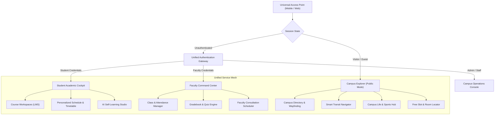
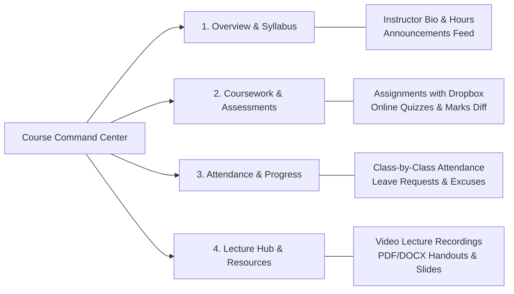
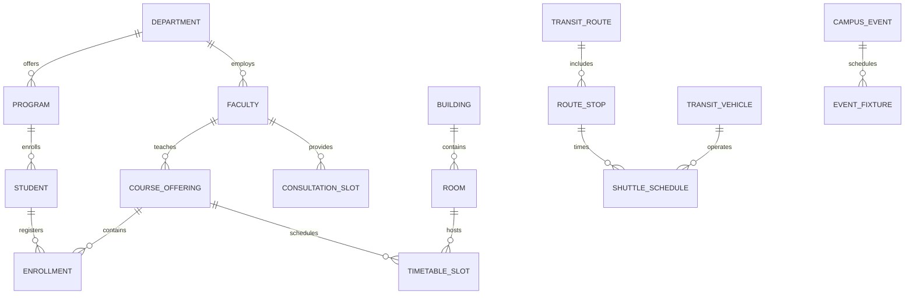

# SmartEdu Enterprise: Campus Platform Product Blueprint (Repolished Edition)

> **Document Class:** Product Requirements Document (PRD) & Technical Architecture Blueprint  
> **Status:** Proposal for Client Verification & Sign-off  
> **Target Audiences:** Executive Leadership, University Registrar, Department HODs, Engineering Team

---

## 1. Executive Transformation Matrix

The client's initial brief outlined an ambitious campus ecosystem but suffered from architectural fragility: disjointed authentication barriers, static tables that decay quickly in real operations, click fatigue, and seasonal modules dominating the top-level navigation. 

Below is the transformation matrix resolving these vulnerabilities into an enterprise-ready platform:

| # | Client's Raw Idea | Vulnerability / Fragility | Repolished Enterprise Specification |
|---|---|---|---|
| **1** | Separate login cards for *Student Portal* and *Faculty* on a public dashboard. | Fragmented authentication, security risk, breaks SSO/RBAC, and confuses multi-role users (e.g., teaching assistants, admins). | **Unified Identity & Adaptive Role-Based Gateway**: Single Sign-On (SSO) with auto-detection of role (Student, Faculty, Admin, Visitor) dynamically rendering a personalized workspace. |
| **2** | Login via Department (BCS) + Reg No (155) + Password. | Brittle; fails for joint majors, dual degrees, campus shifts, or alumni. | **Institutional ID / Unified Identity Provider**: Standardized University ID or email format with optional Biometric / Remembered Device authentication. |
| **3** | Subject card drill-down opens 8 separate cards (Assignments, Quizzes, Marks, etc.). | Extreme click fatigue, fragmented context, and disconnected workflows. | **Unified Course Command Center**: Tabbed, consolidated single-page course cockpit with live progress telemetry, upcoming deadlines, and grading analytics. |
| **4** | "Sports Week" as a primary top-level dashboard module. | Irrelevant for 50 weeks of the year; wastes prime screen real estate. | **Campus Life & Marquee Events Hub**: Dynamic seasonal event spotlighting (Sports Gala, Hackathons, Convocation) with live brackets, ground schedules, and push alerts. |
| **5** | Static Transit Schedule with arrival times at points. | Static times fail when buses face traffic, detours, or mechanical issues. | **Smart Transit & Fleet Telemetry**: Stop-by-stop interactive route navigator, dynamic ETA countdowns, route alerts, and bus tracking integration. |
| **6** | Free Slots listing rooms block-wise per slot. | Static room list lacks booking conflict checks and spatial orientation. | **Dynamic Space Finder & Study Room Engine**: Filter by Block, Floor, Capacity & Amenities (AC, Projector, Outlets) with real-time "Free Until" countdowns and study group booking. |
| **7** | Campus Hub with text-based room/office descriptions. | Text descriptions (e.g., "A Block 3rd Floor") are confusing for new students and visitors. | **Spatial Directory & Interactive Campus Wayfinding**: Visual floor plans, faculty consultation booking, and lab equipment inventories. |
| **8** | Self Assessment card on dashboard without specs. | Omitted details in client brief; lacks pedagogical alignment. | **AI Self-Learning & Adaptive Assessment Studio**: Integrated RAG question generation from course materials, Bloom's Taxonomy MCQs, LaTeX math solvers, and topic mastery radars. |

---

## 2. Information Architecture & Navigation Flow

---

## 3. Module-by-Module Specification

### Module 1: Universal Adaptive Gateway & Dynamic Dashboard

#### Problem Statement
Having distinct "Student Portal" and "Faculty Portal" entry points on the home screen exposes internal system boundaries to the user and breaks when staff take courses or students act as lab demonstrators.

#### Repolished Experience
- **Single Universal Login**: One clean interface accepting either Student Reg No / Employee ID / Institutional Email + Password.
- **Role-Aware Home Layout**:
  - **Student View**: Highlights *Upcoming Class* (with room number countdown), *Attendance Alert Bar*, *Enrolled Courses Grid*, and *Quick Actions* (Free Rooms, Shuttle Tracker, Library).
  - **Faculty View**: Highlights *Today's Lecture Schedule*, *Pending Grade Submissions*, *Quick Attendance Mark*, and *Room Reservation*.
  - **Visitor / Open Campus View**: Allows prospective students and guests to explore the campus map, public transit schedules, directory, and event feeds without credentials.

---

### Module 2: Student Academic Cockpit & Course Command Center

#### Problem Statement
The client proposed drilling down into 8 separate sub-cards per subject. Navigating backward and forward between 8 screens across 5 subjects causes friction and cognitive overload.

#### Repolished Experience
Each enrolled subject is represented by a high-density, interactive card displaying:
- **Course Metadata**: Title, Code, Credit Hours, Section, Primary Instructor (with profile picture and status).
- **Attendance Dial / Progress Bar**: Color-coded (Green $\ge 80\%$, Amber $75-79\%$, Red $<75\%$ regulatory warning).
- **Current Standing**: Aggregate grade estimate (e.g., $84\%$ / A-) and next upcoming deadline.

#### Detailed Subject Screen (Consolidated 4-Tab Workspace)
Instead of 8 disjointed screens, clicking a course opens a tabbed workspace:

1. **Overview & Announcements**: Syllabus timeline, grading policy, and instructor broadcast messages.
2. **Coursework & Assessments**: Combined list of Assignments, Quizzes, and Exam results with grade statistics and rubric feedback.
3. **Attendance & Absence Ledger**: Date-by-date attendance record with 1-click medical/leave excuse submission.
4. **Lecture Hub & Material Vault**: Synchronized lecture notes, recorded lectures, slides, and supplementary reading.

---

### Module 3: Intelligent Timetable & Schedule Engine

#### Problem Statement
Static PDF timetables or raw tables are difficult to parse on mobile devices and don't notify users of room swaps or cancellations.

#### Repolished Experience
- **Adaptive Viewports**:
  - **Day Timeline**: Hour-by-hour visual schedule with a moving red "Current Time" indicator and "Next Lecture in 25m" banner.
  - **Weekly Matrix**: High-level block schedule color-coded by course.
- **Deep Timetable Context**:
  - Course Code & Name
  - Room Location (with 1-click "Show on Map" link)
  - Instructor Name & Section Designation (e.g., *BCS-7C*)
  - Room Capacity vs. Enrolled Students indicator
- **Real-Time Swap Alerts**: Live badge updates when a class is rescheduled, moved to another hall, or moved online.
- **Calendar Export**: 1-click sync to Google Calendar, Apple Calendar, and Microsoft Outlook (.ics).

---

### Module 4: Dynamic Space Finder & Free Slot Navigator

#### Problem Statement
Students needing empty classrooms for project meetings or study groups often wander campus corridors peeking through door windows.

#### Repolished Experience
- **Time Slot Selector**: Filter by Day (Monday–Saturday) and Slot (Slot 1: 08:30–10:00, Slot 2: 10:15–11:45, etc.) or click "Available Right Now".
- **Multi-Block Navigation**: Collapsible accordions or horizontal tabs for **Block A**, **Block B**, **Block C**, **Block D**, and **Engineering Labs**.
- **Room Card Telemetry**:
  - Room Code & Floor (e.g., *Room C-204, 2nd Floor*)
  - Student Seating Capacity
  - Available Equipment: Overhead Projector, High-Density Wi-Fi, Air Conditioning, Power Sockets at desks
  - "Free Until" indicator (e.g., *Free until 01:15 PM — Next: SE-4A Lab*)
- **Study Group Reservation (Optional Governance)**: Authorized students can reserve a free room for up to 90 minutes; automatically releases if not checked-in via QR code.

---

### Module 5: Smart Transit & Fleet Telemetry

#### Problem Statement
Fixed transit timetables fail because buses experience urban traffic delays. Students arrive at pickup stops only to find the shuttle has already left or is 30 minutes late.

#### Repolished Experience
- **Two Core Navigation Paths**:
  1. **City Route Networks (Morning Inbound & Evening Outbound)**: Comprehensive route maps (e.g., *Farid Town Point*, *Mall Road Express*, *Canal Line*).
  2. **Inter-Campus / Intra-Day Shuttles**: High-frequency loops between hostels, main campus, and athletic complexes.
- **Stop-by-Stop Itinerary**:
  - Visual timeline indicating every stop along the line.
  - Scheduled Time vs. Estimated Actual Arrival (ETA).
  - Designated Bus Number, Driver Contact, and Bus Capacity status (*Seats Available*, *Standing Only*, *Full*).
- **Service Disruption Notices**: Instant banner alerts for route deviations, vehicle maintenance, or weather delays.

---

### Module 6: Campus Hub, Directory & Spatial Wayfinding

#### Problem Statement
Text instructions like "A Block, 3rd Floor" cause disorientation in large multi-wing university buildings.

#### Repolished Experience
A centralized campus information registry divided into specialized directories:
- **Faculty & Leadership Directory**: Search by Name, Department, or Designation (Dean, HOD, Batch Advisor, Lecturer). Each profile includes Office Room Number, Official Email, Consultation Hours, and a direct "Request Meeting" button.
- **Office & Administrative Services**: Registrar, Accounts/Fee Counter, Career Placement, Examination Branch, and Medical Center with working hours and ticket queue status.
- **Classrooms & Specialized Labs**: Complete directory of Computer Labs, Physics/Robotics Labs, Auditoriums, and Seminar Halls categorized by Block and Floor with equipment inventories.
- **Library Intelligence**: Current silent-study seat availability, digital catalog lookup, and borrowing status.
- **Interactive Floor Plans**: Floor-by-floor vector blueprints highlighting the exact room on selection.

---

### Module 7: Campus Life, Marquee Events & Sports Gala Portal

#### Problem Statement
Hardcoding "Sports Week" leaves an empty, obsolete module on the dashboard for 11 months of the year.

#### Repolished Experience
- **Marquee Event Architecture**: Dynamically morphs depending on the university calendar:
  - *Sports Week / Olympiad Mode* (Spring)
  - *Tech Gala / Hackathon Mode* (Fall)
  - *Career Fair & Convocation Mode* (Winter)
- **Tournament Engine**:
  - Live Fixture Schedule filtered by Day, Sport (Cricket, Futsal, Badminton, Basketball, Chess), or Department.
  - Match Venue / Ground Location (e.g., *Main Cricket Oval*, *Gymnasium Court 2*).
  - Live Scoreboard & Elimination Brackets.
  - Department Points Table / Overall Trophy Standings.
- **Notification Subscriptions**: Students can follow their department or sport to receive match-start push alerts.

---

### Module 8: AI Self-Learning & Adaptive Assessment Studio

*(Leveraging the platform's Phase 1–4 Gemini RAG & LangGraph Foundation)*

#### Problem Statement
Students need personalized diagnostic feedback and exam preparation beyond static lecture handouts.

#### Repolished Experience
- **Subject Ingestion Vault**: Upload syllabus, lecture slides, and past papers (.pdf, .docx, .pptx) with automated deduplication and topic indexing.
- **Bloom's Taxonomy Test Generator**: Generates custom practice tests (Recall, Analytical Synthesis, Numerical Solvers with LaTeX proofs).
- **Diagnostic Feedback & Mastery Profiler**:
  - Instant scoring with document-cited explanations.
  - Radar charts tracking mastery across syllabus topics (*Strong $\ge 75\%$*, *Moderate $50-74\%$*, *Weak $<50\%$*).
  - 1-Click "Smart Regenerate" focusing on identified knowledge gaps.

---

## 4. Technical Feasibility & Entity Relationship Map

---

## 5. Client Alignment & Verification Checklist

Before starting implementation, present these 5 strategic architectural questions to the client:

1. **Authentication Strategy**:
   * *Proposed:* Unified login with institutional ID (Student/Teacher/Staff) and automatic role redirection.
   * *Question for Client:* "Do you require separate branded portals for teachers and students, or do you prefer a single login screen that automatically adapts based on who signs in?"

2. **Event Hub Scope**:
   * *Proposed:* "Campus Life & Events" module that features Sports Week during game season and highlights other campus events year-round.
   * *Question for Client:* "Should Sports Week remain an isolated standalone module all year, or should it be housed inside an active Campus Life & Events hub that also powers hackathons and career fairs?"

3. **Space Finder Booking Rights**:
   * *Proposed:* View-only free room finder for students, with optional booking reserved for Faculty/Staff or pre-approved student study groups.
   * *Question for Client:* "Should students be able to reserve free classrooms directly from the app, or should it strictly be a read-only viewer for finding study spaces?"

4. **Transit Tracking Fidelity**:
   * *Proposed:* Phase 1 scheduled stops with live ETA estimates; Phase 2 hardware GPS bus tracker.
   * *Question for Client:* "Are university buses equipped with GPS hardware for live map tracking, or do we start with the planned stops and driver-updated timetable schedule?"

5. **Self-Assessment AI Engine**:
   * *Proposed:* Connect the Student Portal directly to our Gemini AI test generator and study material uploader.
   * *Question for Client:* "Would you like students to generate quizzes from their own uploaded notes and syllabus slides via AI?"

---
*Blueprint prepared for client presentation. No code modifications will occur until client validation is confirmed.*
